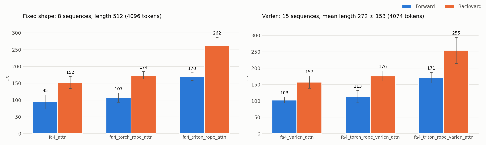
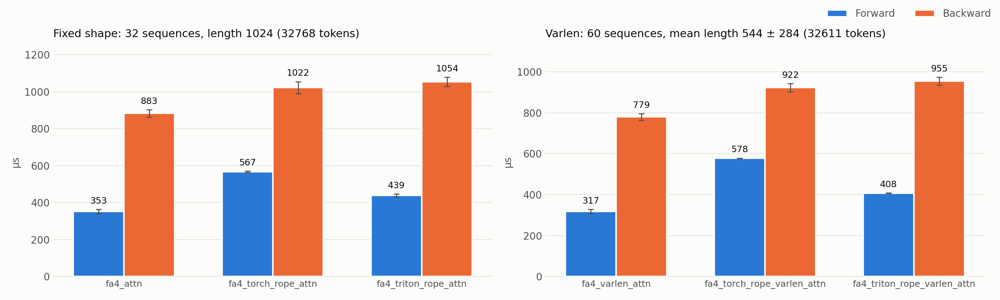
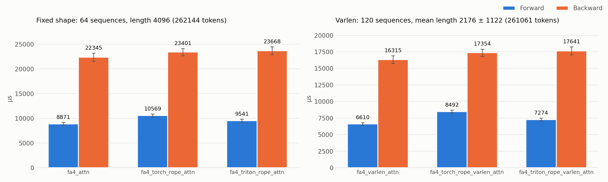

# flash-attn-4

Example code for
[FlashAttention 4](https://github.com/Dao-AILab/flash-attention), with and
without fused RoPE, for training with `torch.compile` on Hopper (H100) and
Blackwell (B200). Each version runs FA4's CuTeDSL kernel, from
[`flash_attn/cute`](https://github.com/Dao-AILab/flash-attention/tree/main/flash_attn/cute),
and RoPE if fused, inside one
[`torch.library.custom_op`](https://docs.pytorch.org/docs/stable/library.html#torch.library.custom_op),
forward and backward.

```bash
examples/
  attn.py                      # fixed-shape (B, S, 3, H, D) qkv, no RoPE
  attn_torch_rope.py           # same, with plain-torch RoPE before the op (unfused baseline)
  attn_triton_rope.py          # same, with triton RoPE fused into the op
  attn_varlen.py               # packed (T, 3, H, D) qkv + cu_seqlens, no RoPE
  attn_torch_rope_varlen.py    # same, with plain-torch RoPE before the op (unfused baseline)
  attn_triton_rope_varlen.py   # same, with triton RoPE fused into the op
tests/                         # GPU tests skip below sm90
```

Each file is a standalone, copy-and-paste example: the custom ops, the RoPE
code (if any), a small attention layer and a compiled training loop. The
duplicated code between files is deliberate.

## Design

**Custom op.** On B200, `torch.compile` traces into FA4's CuTeDSL Python, and
the JIT then runs on every pass, making compiled training much slower than
eager. As a custom op, attention is opaque to the compiler. On H100 this is
also slightly faster: it removes about a dozen graph breaks per attention call.
FA4 doesn't register its own custom ops yet;
[#2154](https://github.com/Dao-AILab/flash-attention/issues/2154) is the
upstream plan to add them.

**Private backward.** As an optimization, the backward ops call FA4's private
`_flash_attn_bwd`, which writes `dq`/`dk`/`dv` into caller-supplied buffers
(see the next section).
`tests/fa4_private_api_test.py` checks the parts the examples rely on; run it
after upgrading flash-attn.

**One `dqkv` buffer, RoPE inside the op.** Given separate q, k, v, autograd
stacks `dq`, `dk` and `dv` into the packed QKV gradient. With RoPE outside the
op, Inductor fuses that stack with the RoPE backward into a pure
memory-movement kernel that reads and writes all three gradients. Here, every
op takes the packed qkv and FA4's backward writes into strided views of one
`dqkv` buffer. The RoPE ops then run RoPE's transpose in place on its q/k
slots, so that copy never happens. The backward recomputes the rotated q/k
instead of saving it, so each layer keeps only `qkv` for backward.

**RoPE autotuning.** The triton kernel is
[autotuned](https://triton-lang.org/main/python-api/generated/triton.autotune.html).
The varlen files key on the head shape only, because their token count changes
every step. The fixed-shape file also keys on `T = B * S`, which is constant,
and shares one `(S, D/2)` cos/sin table across the batch (token `t` reads row
`t % S`).

## Setup

Requires Linux (FA4 and triton only ship Linux wheels) and an NVIDIA Hopper
(sm90) or newer GPU. This is example code only; it doesn't build or install a
library.

```bash
# from the repo root
uv sync --extra flash-attn-4 && source .venv/bin/activate
cd studies/flash-attn-4
pytest                     # GPU tests skip below sm90
python examples/attn_triton_rope_varlen.py  # warmup, then 100 timed steps
```

Run everything from this directory with the root environment activated. The
dependencies come from the root `pyproject.toml`.

## Usage

Each example defines one attention layer and trains it with `torch.compile` under
`main()`, with fp32 weights and a bf16
[autocast](https://docs.pytorch.org/docs/stable/amp.html) forward.

| File | Input | RoPE | Op | No `dq`/`dk`/`dv` stack |
| --- | --- | --- | --- | --- |
| `attn.py` | `(B, S, dim)` | none | `fa4_attn` | ✓ |
| `attn_torch_rope.py` | `(B, S, dim)` | plain torch, before the op | `fa4_attn` | ✗ |
| `attn_triton_rope.py` | `(B, S, dim)` | triton, fused into the op | `fa4_rope_attn` | ✓ |
| `attn_varlen.py` | packed `(T, dim)` | none | `fa4_varlen_attn` | ✓ |
| `attn_torch_rope_varlen.py` | packed `(T, dim)` | plain torch, before the op | `fa4_varlen_attn` | ✗ |
| `attn_triton_rope_varlen.py` | packed `(T, dim)` | triton, fused into the op | `fa4_rope_varlen_attn` | ✓ |

The examples use `dim=1024`, `heads=16`; fixed-shape `B=8, S=1024`; varlen 8
sequences of 64–1023 tokens.

The torch-RoPE files are the unfused baseline: rebuilding qkv after RoPE makes
autograd stack the q, k, v gradients, which is the cost described under Design.

All ops work the same eager or inside `torch.compile(..., fullgraph=True)`. The
fixed-shape ops take `(B, S, 3, H, D)` qkv and return `(B, S, H, D)`; the varlen
ops take packed `(T, 3, H, D)` qkv plus `cu_seqlens` and `max_seqlen` and return
`(T, H, D)`. Fused-RoPE ops also take fp32 `cos`/`sin` tables: `(S, D/2)` for
fixed shapes, `(T, D/2)` for varlen with positions restarting per sequence.
Every op also takes a keyword-only `causal` (default `False`).

## Slurm

Submit the kernel benchmark from this directory:

```bash
cd studies/flash-attn-4 && sbatch slurm/benchmark.sbatch
```

The logs and the plots are written to `slurm/` as `<jobid>-stdout.txt`,
`<jobid>-stderr.txt` and `<jobid>-benchmark-<size>.png`.

## Results

### System

```text
System
  python     : 3.14.3
  platform   : Linux-5.15.0-181-generic-x86_64-with-glibc2.35
  cpu        : AMD EPYC 9654 96-Core Processor
  cpu_cores  : 24 (of 192)
  ram_gb     : 2262.3
  numpy      : 2.4.6
  torch      : 2.14.1
  gpu        : NVIDIA H100 80GB HBM3
  gpu_mem_gb : 79.6
  gpu_driver : 580.159.03
  git        : c48153d
```

### Kernel performance

Forward and backward time of each op on its own, on H100, at three input sizes.
Each op is compiled with `torch.compile(fullgraph=True)`, as in training. The
`torch_rope` rows time plain-torch RoPE followed by the attention op, so their
backward includes Inductor's fused RoPE-backward and stack kernel. Mean,
standard deviation and IQR are over `do_bench`'s runs. Reproduce with
`python benchmark.py benchmark.png`, which prints these tables and saves one
plot per size (`benchmark-small.png`, and so on).

All sizes use `heads=16`, `head_dim=64`. The varlen input has about the same
number of tokens as the fixed shape, in sequences with evenly spaced lengths
from `S/16` to `S`, in a random order.

#### Small

Fixed shape 8 sequences, length 512 (4,096 tokens); varlen 15 sequences, mean length 272 ± 153.



| Op | Fwd mean ± std (µs) | Fwd IQR | Bwd mean ± std (µs) | Bwd IQR |
| --- | --- | --- | --- | --- |
| `fa4_attn` | 94.7 ± 21.2 | 3.4 | 152.4 ± 17.8 | 4.7 |
| `fa4_torch_rope_attn` | 107.1 ± 13.6 | 4.0 | 174.0 ± 11.0 | 3.9 |
| `fa4_triton_rope_attn` | 170.1 ± 11.1 | 4.3 | 262.2 ± 24.6 | 7.6 |
| `fa4_varlen_attn` | 102.6 ± 9.2 | 3.0 | 157.4 ± 18.6 | 4.7 |
| `fa4_torch_rope_varlen_attn` | 113.4 ± 18.7 | 3.3 | 176.3 ± 15.6 | 5.8 |
| `fa4_triton_rope_varlen_attn` | 171.3 ± 15.9 | 4.9 | 254.5 ± 39.8 | 7.8 |

#### Medium

Fixed shape 32 sequences, length 1024 (32,768 tokens); varlen 60 sequences, mean length 544 ± 284.



| Op | Fwd mean ± std (µs) | Fwd IQR | Bwd mean ± std (µs) | Bwd IQR |
| --- | --- | --- | --- | --- |
| `fa4_attn` | 352.7 ± 11.7 | 14.6 | 883.4 ± 20.2 | 19.8 |
| `fa4_torch_rope_attn` | 567.2 ± 3.5 | 1.4 | 1022.3 ± 32.3 | 38.1 |
| `fa4_triton_rope_attn` | 438.6 ± 7.9 | 3.0 | 1053.6 ± 25.4 | 29.4 |
| `fa4_varlen_attn` | 317.1 ± 10.4 | 0.9 | 779.3 ± 16.0 | 22.0 |
| `fa4_torch_rope_varlen_attn` | 577.7 ± 0.9 | 1.2 | 922.4 ± 19.8 | 24.1 |
| `fa4_triton_rope_varlen_attn` | 407.6 ± 1.2 | 1.2 | 954.7 ± 19.0 | 17.6 |

#### Large

Fixed shape 64 sequences, length 4096 (262,144 tokens); varlen 120 sequences, mean length 2176 ± 1122.



| Op | Fwd mean ± std (µs) | Fwd IQR | Bwd mean ± std (µs) | Bwd IQR |
| --- | --- | --- | --- | --- |
| `fa4_attn` | 8870.7 ± 291.8 | 465.5 | 22344.6 ± 832.9 | 1345.4 |
| `fa4_torch_rope_attn` | 10568.5 ± 318.8 | 448.8 | 23401.2 ± 723.1 | 1176.0 |
| `fa4_triton_rope_attn` | 9540.6 ± 272.8 | 415.3 | 23667.9 ± 797.8 | 1216.1 |
| `fa4_varlen_attn` | 6610.5 ± 200.0 | 246.6 | 16315.4 ± 580.2 | 936.1 |
| `fa4_torch_rope_varlen_attn` | 8491.9 ± 218.8 | 302.6 | 17353.6 ± 552.1 | 907.1 |
| `fa4_triton_rope_varlen_attn` | 7274.0 ± 223.8 | 325.6 | 17640.8 ± 613.1 | 908.5 |
